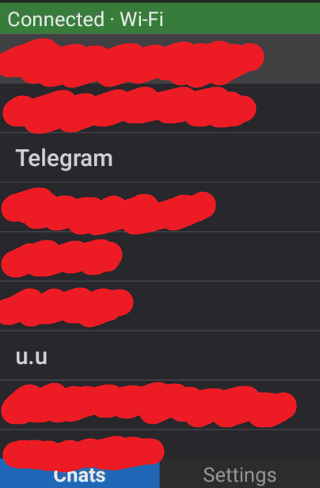
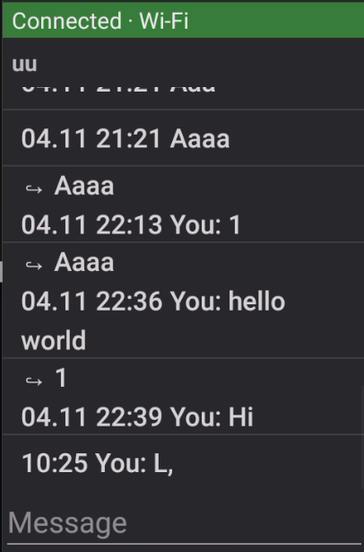
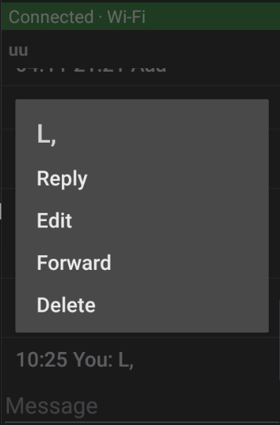
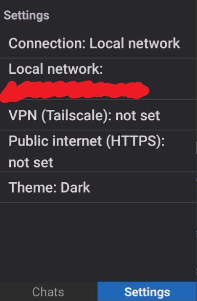
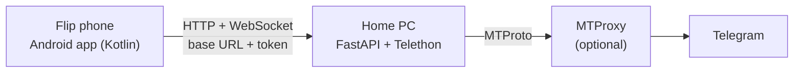

# Telegram Flip Client

A personal, study-oriented project: use Telegram on an Android 10 flip phone with a d-pad, in a region where Telegram is blocked. A Python server on my own PC talks to Telegram, and a native Android app on the phone talks to that server. Important: vibecoded with Claude!

Built step by step as a way to learn Git/GitHub, async Python, APIs, authentication, WebSockets, Android and Kotlin, and UI design under hardware constraints.

## Screenshots

| Chat list | A chat | Message menu | Settings |
|---|---|---|---|
|  |  |  |  |

## Features

- Chat list with profile photos, live unread counts, a preview of the newest message, newest activity on top, and "Show more chats" for older ones. Photos are shrunk to tiny thumbnails on the server (about 1–2 KB each) and kept on both sides
- Folders of your own on the phone: a total unread counter, and a folder can hide its chats from the main list (an alternative to archiving)
- Forum groups (groups split into topics): a topic list, and each topic as its own chat
- Read and send messages; "Load older messages" for history
- Photos: open one from the message menu to see it full screen, then zoom, move around, rotate it or download the full-size original into the phone's Pictures/TG Flip folder from the F2 menu. The server shrinks it to the phone's screen size first (about 30–60 KB instead of several MB), and both sides keep a copy. Send your own from the F2 menu, picked in the phone's picture folder: optimized on the phone (about 1280 px, a few hundred KB, quick over a slow connection) or the original file; text in the message box becomes the caption
- Videos: play them from the message menu. The phone downloads the whole video first (up to 100 MB), then plays it smoothly from its own copy; OK pauses, Left/Right jump 10 seconds. Send your own from the F2 menu (Send media > Send video, up to 100 MB), optimized on the phone (480 px, about 8 MB a minute, much quicker through a slow proxy) or as the original, with the length and a preview picture so it shows properly in other Telegram apps
- Stickers: a small still picture right in the chat (animated and video stickers show their preview picture), View sticker for the full size, or text only in data saver mode (Settings > Media and Cache). Custom emoji show as small pictures inside text and reactions too. Send stickers from the F2 menu: your recent and favorite stickers and your packs, picked from a grid. From a sticker in a chat, open its pack and add it to yours; F2 on a sticker adds it to Favorites (Telegram's, 5 without Premium) or to local favourites (the app's own, no limit), or gives it your own description, which shows in data saver mode
- Round video messages: played like videos, under a round mask so they look round
- Voice messages: play them from the message menu, with a running time on the message line, and record your own from the F2 menu (up to 5 minutes; OK sends, Back discards). They are kept on the phone like photos, and listening does not tell the sender
- Message menu on OK: view a photo, play a video, play a voice message, reply, react, edit (own messages), forward, delete (only the options Telegram allows: "for me" and/or "for everyone"), view the writer's profile, and in groups message them privately
- Profiles: photo, name, and username and phone number where the person lets you see them
- Group info: photo, member count and the member list with photos and admin marks (where Telegram shows it)
- Replies show a quote of the original; edited messages show "(edited)"; reactions show in a small line under the message (yours in bold) and update live; add your own from the message menu (React…), with your most used ones first
- Live updates over a WebSocket (new, edited and deleted messages), with automatic reconnect and a resync afterwards
- "Mark as read" as a deliberate action on the F1 soft key, so read receipts are never sent by accident; a soft key label shows when there is something to mark
- Quick phrases: saved phrases (set up in Settings) you drop into the message box from the F2 soft key menu, since typing on a keypad is slow
- Offline reading: the last chats, topics and messages are kept on the phone
- Cache settings: how long media is kept and how much space it may take (presets or your own numbers), clearing it, an optional separate cache for stickers with its own limits, and deleting all saved data for a fresh start
- Soft key labels in the phone's own soft key boxes on Japanese Android flip phones (NextFP, like my Kyocera); other phones get the app's own label bar. A Settings switch picks which one shows
- On the version line in Settings: F2 opens that version's release notes, Right ("under the hood") shows the server's log, live
- Several phones can use the same account on one server at the same time
- Connection status bar on every screen
- Settings: server address per connection mode (local network, VPN, public internet over HTTPS), app token, theme (light, dark, follow phone)
- Built for the d-pad: every action works with Up/Down, OK, Left/Right, Back and the soft keys

## Architecture



The phone and the server only share a **base URL and a token**. How the phone reaches the server is deliberately a separate layer (the app's connection modes), so it can be swapped without touching app logic.

## Getting it running

Both downloads are on the [Releases](https://github.com/q43b/telegram-flip-client/releases) page.

### 1. The server (Windows)

1. Get your own API ID and API hash at https://my.telegram.org ("API development tools").
2. Download `tgflip-server-<version>-win64.zip`, unzip it anywhere and double-click `tgflip-server.exe`.
3. The first run asks for the API ID and hash, an MTProxy (only if Telegram is blocked for you; press Enter to skip) and the app token (press Enter to generate one). Then it logs in to Telegram: phone number, the code Telegram sends, and your 2FA password if you have one.
4. If Windows Firewall asks, allow it on private networks.

Later runs just start. Settings and the login stay next to the exe (`.env`, `tg_session.session`).

> **The phone can't connect although the server started?** Windows probably treats your home Wi-Fi as a "Public" network, where it blocks incoming connections. Set it to Private: Settings > Network & internet > Wi-Fi > (your network) > Network profile type > Private.

### 2. The app (Android 7 or newer)

1. Download `TG-Flip-<version>.apk` to the phone and install it (allow installing from unknown sources if asked).
2. On first start, enter the server: your PC's IP address on the home network (e.g. `192.168.1.20`), port `9436`, and the app token. The phone must be on the same Wi-Fi as the PC (routers often have separate 2.4 GHz and 5 GHz networks: pick the PC's). On newer Android versions, allow "Nearby devices" when asked: that's how Android lets apps reach your home network.

### Keys

| Key | Chat list | Chat | Elsewhere |
|---|---|---|---|
| Up / Down | Move through chats | Move through messages | Move through lists |
| OK | Open chat (or topic list) | Message menu; in the text box: send | Choose |
| Right | Open Settings | Group info (groups and channels) | |
| Left | | | Close Settings, a profile, group info or a photo |
| F1 (left soft key) | | Mark as read | |
| F2 (right soft key) | Open a forum's General topic | Menu: quick phrases, stickers, send media (a photo or a video), record a voice message | |
| Back | | Cancel a reply or edit, otherwise leave | Go back |

## Building from source

### Server

```powershell
git clone https://github.com/q43b/telegram-flip-client.git
cd telegram-flip-client
python -m venv venv
.\venv\Scripts\Activate.ps1
pip install -r server\requirements.txt
cd server
python run_server.py
```

`run_server.py` does the same first-run setup as the packaged server. Alternatively, copy `server/.env.example` to `server/.env`, fill it in, and run `uvicorn server:app --host 0.0.0.0 --port 9436` (log in once with `python list_chats.py`).

To build the Windows zip: `pip install -r server\requirements-build.txt`, then `powershell -ExecutionPolicy Bypass -File server\build_server.ps1`. It lands in `dist/`.

### App

Open `android/` in Android Studio. **Run** installs a dev build, a separate app called "TG Flip (dev)", so it sits next to a release install.

Release builds (`gradlew assembleRelease`) are signed with your own key: create one with `keytool`, then copy `android/keystore.properties.example` to `android/keystore.properties` and fill it in. That file and the key are git-ignored. Without them, release builds come out unsigned.

## Project layout

```
android/                   The Android app (Kotlin, Views)
  app/src/main/java/...    Screens (MainActivity, TopicsActivity, ChatActivity, SettingsActivity),
                           ApiClient, LiveConnection, LocalCache, ConnectionMode, ...
server/
  server.py                FastAPI app: REST endpoints, WebSocket, Telethon client
  run_server.py            Start script: first-run setup, Telegram login, then the server
  build_server.ps1         Builds the packaged Windows server (PyInstaller)
  packaging/README.txt     The README inside the server zip
  static/                  The earlier web client, still served at http://<PC>:9436/
  list_chats.py            One-off script: log in and list chats
  listen.py                One-off script: print incoming messages
docs/screenshots/          Screenshots for this README
PROJECT_BRIEF.md           Goals, decisions, milestones
```

## Security notes

- The Telegram session file gives full access to the account. It is git-ignored, never packed into the server zip, and must never be shared.
- Secrets live in `.env`, not in code. Token comparison uses `secrets.compare_digest`. The WebSocket token is sent as the first message, not in the URL, so it does not end up in logs.
- Message text is always shown as plain text, never interpreted as HTML.
- On the local network and inside a VPN the app uses plain HTTP; in the "Public internet" connection mode it always uses HTTPS, so the token and messages never cross the open internet readable. The server itself is meant for a trusted network; don't expose it to the internet without HTTPS in front.
- Messages saved for offline reading are kept in the app's private storage and excluded from phone backups.
- Release APKs are signed; the signing key and its passwords never enter the repository.

## Design decisions worth noting

- **Native app instead of the phone's browser:** in the browser, the d-pad moved focus two items at a time. The native app handles keys directly. On screens with a text box, the phone's keyboard app swallows OK before the app sees it, so the message list takes OK in `onKeyPreIme`, which runs first.
- **Push plus resync:** the WebSocket only delivers new events, so after a reconnect the app refetches current state instead of trusting what it saw before.
- **Keeping the user in control:** opening a chat never marks it as read; that is a separate key press, because it sends a read receipt.
- **Resilience behind a flaky proxy:** the MTProxy sometimes leaves the Telegram connection broken (`MTPROTO_CLUSTER_INVALID`). The server reconnects from scratch and retries the request once, and a watchdog checks the connection every two minutes.
- **Forum unread counts:** Telegram's own unread counter for a forum group goes stale, so the server adds up the topics' counts instead.

## Known limitations and roadmap

- **Home network only for now.** The home connection is behind carrier-grade NAT, and the remote-access options tried (Tailscale, tunnels, a rented server) are blocked or ruled out where I live. The app's VPN and Public modes are ready for when a route exists.
- **Text, photos, videos and voice in chats:** GIFs and files show as "[media]"; animated stickers don't play yet. Voice messages play and record on Android 10 and newer (Settings already has a switch for Android 7–9, for a compatible format that comes later).
- The packaged server is Windows-only.
- Planned: reactions, stickers, and other media.

## Credits

- [Telethon](https://github.com/LonamiWebs/Telethon) for the Telegram client
- [tg-ws-proxy](https://github.com/Flowseal/tg-ws-proxy) by Flowseal (MIT), the MTProxy I use, as a separate program and not included in this repo
- [OkHttp](https://square.github.io/okhttp/) for HTTP and WebSockets in the app
- [PyInstaller](https://pyinstaller.org/) for the packaged server

## License

MIT, see [LICENSE](LICENSE).

## Disclaimer

This is a personal project using my own Telegram account through the official API. It is not affiliated with or endorsed by Telegram.
