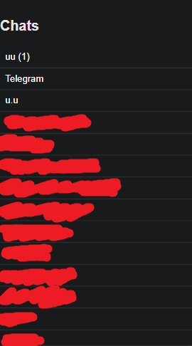
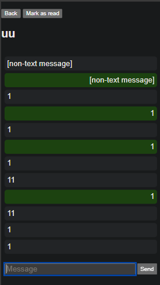
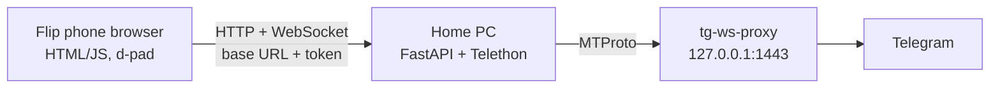

# Telegram Flip Client

A personal, study-oriented project: use Telegram on an Android 10 flip phone with a d-pad, in a region where Telegram is blocked. A Python backend on my own PC talks to Telegram, and a small web app on the phone talks to that backend. Important: vibecoded with Claude!

Built step by step as a way to learn Git/GitHub, async Python, APIs, authentication, WebSockets, and UI design under hardware constraints.

## Screenshots

| Chat list | A chat |
|---|---|
|  |  |

## Features

- Chat list with live unread counts; the most recently active chat moves to the top
- Read and send messages
- Live updates over a WebSocket, with automatic reconnect and a resync after reconnecting
- "Mark as read" as a deliberate action (button, or the F2 soft key), so read receipts are never sent by accident
- Read state stays in sync with other Telegram clients
- Visible connection status and error messages on the small screen
- D-pad navigation (Up/Down moves focus, Enter activates) and large, high-contrast focus outlines
- Token authentication on both the HTTP API and the WebSocket

## Architecture



The phone and the server only share a **base URL and a token**. How the phone reaches the server is deliberately a separate layer, so it can be swapped later without touching app logic.

## Tech stack

- **Backend:** Python 3.13, [Telethon](https://github.com/LonamiWebs/Telethon) (MTProto client), FastAPI, uvicorn, WebSockets
- **Frontend:** plain HTML, CSS and JavaScript served by the backend (no build step)
- **Telegram access:** any local MTProto proxy works, or a VPN, or maybe Telegram works for you by itself; I use tg-ws-proxy by Flowseal (MIT license) https://github.com/Flowseal/tg-ws-proxy

## Project layout

```
server.py            FastAPI app: REST endpoints, WebSocket, Telethon client
list_chats.py        One-off script: log in, list chats, send a test message
listen.py            One-off script: print incoming messages
static/index.html    The phone UI
static/keys.html     Tool: shows which key codes the phone sends
static/debug.html    Tool: checks which JavaScript features the phone's browser supports
PROJECT_BRIEF.md     Goals, decisions, milestones
```

## Packaged server (Windows, easiest)

Download `tgflip-server-<version>-win64.zip` from [Releases](https://github.com/q43b/telegram-flip-client/releases), unzip it and double-click `tgflip-server.exe`. The first run asks for your API ID and hash, an optional MTProxy and the app token, then logs in to Telegram. Settings and the login stay next to the exe (`.env`, `tg_session.session`). See `README.txt` inside the zip.

To build the zip yourself: install `server/requirements-build.txt` into the venv, then run `powershell -ExecutionPolicy Bypass -File server\build_server.ps1`.

## Setup from source (Windows, PowerShell)

1. Get your own `api_id` and `api_hash` at https://my.telegram.org.
2. (Optional, can skip if TG works already) Run a local MTProto proxy (I use tg-ws-proxy) and note its host, port and secret.
3. Clone the repository:

   ```powershell
   git clone https://github.com/q43b/telegram-flip-client.git
   cd telegram-flip-client
   ```
4. Create a virtual environment and install dependencies:

   ```powershell
   python -m venv venv
   .\venv\Scripts\Activate.ps1
   pip install -r requirements.txt
   ```

5. Create a `.env` file (never commit it):

   ```
   API_ID=...
   API_HASH=...
   PROXY_HOST=127.0.0.1
   PROXY_PORT=1443
   PROXY_SECRET=...
   API_TOKEN=a-long-random-string
   ```

   Generate a token with `python -c "import secrets; print(secrets.token_urlsafe(32))"`.

6. Log in once (this creates the session file) (sometimes needs to be rerun, it tells you when):

   ```powershell
   python list_chats.py
   ```

7. Start the server:

   ```powershell
   uvicorn server:app --host 0.0.0.0
   ```

8. On the phone (same Wi-Fi), open `http://<PC-IP>:8000/#token=<API_TOKEN>`. The token is stored on the phone and removed from the address bar.

## Security notes

- The Telegram session file gives full access to the account. It is git-ignored and must never be shared.
- Secrets live in `.env`, not in code. Token comparison uses `secrets.compare_digest`.
- The WebSocket token is sent as the first message, not in the URL, so it does not end up in logs.
- Message text is inserted with `textContent`, never `innerHTML`, so a message cannot inject HTML or scripts into the page.
- The server speaks plain HTTP and is meant for a trusted home network only. Do not expose it to the internet without HTTPS, rate limiting and stronger authentication.

## Design decisions worth noting

- **Old-browser compatibility:** the phone's built-in browser does not support optional chaining. A small test page (`debug.html`) reports what it supports, and the UI is written in conservative JavaScript.
- **Push plus resync:** the WebSocket only delivers new events, so after a reconnect the page refetches current state instead of trusting what it saw before.
- **Keeping the user in control:** reading and acknowledging are separate actions, because acknowledging sends a read receipt.

## Known limitations and roadmap

- Home Wi-Fi only. Remote access is blocked by carrier-grade NAT on the home connection; options are being evaluated.
- On the phone's built-in browser, d-pad Up/Down moves focus two items at once. The key tester shows one event per press, so this looks like browser behavior; a native Android app is planned to handle key events directly.
- Text messages only: other message types are shown as "[non-text message]".
- Planned: native Android app, move the server to an always-on machine.

## Credits

- [tg-ws-proxy](https://github.com/Flowseal/tg-ws-proxy) by Flowseal (MIT), used as a separate program and not included in this repo
- [Telethon](https://github.com/LonamiWebs/Telethon) for the Telegram client

## Disclaimer

This is a personal project using my own Telegram account through the official API. It is not affiliated with or endorsed by Telegram.
